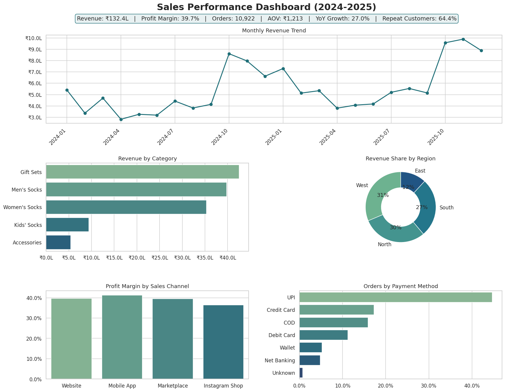

# Sales Data Analysis: D2C E-commerce

End-to-end exploratory analysis of **12,000+ sales records** for an Indian direct-to-consumer (D2C) brand, covering data cleaning, KPI tracking, trend analysis and a one-page performance dashboard.



## Business questions
- How is revenue trending month over month and year over year?
- Which categories, regions and sales channels drive revenue and margin?
- When do customers buy (season, weekday) and how do they pay?
- How concentrated is revenue among repeat customers?

## Tech stack
Python · Pandas · NumPy · Matplotlib · Seaborn · Jupyter Notebook

## Dataset
The dataset is **synthetic**, generated by `src/generate_data.py` to mirror realistic D2C patterns: festive-season peaks (Oct–Nov), weekend uplift, year-on-year growth, repeat buyers, multi-channel sales (Website, Mobile App, Marketplace, Instagram Shop) and Indian payment methods (UPI, COD, cards).

It also contains deliberate data-quality problems so the cleaning step reflects real work:

| Issue | Rows affected | Fix |
|---|---|---|
| Duplicate orders | 150 | Dropped exact duplicates |
| Missing region | 90 | Imputed from state |
| Missing payment method | 90 | Labelled "Unknown" |
| Inconsistent channel labels (case/whitespace) | ~400 | Trimmed and title-cased |
| Quantity ≤ 0 | 25 | Removed |
| Sales entry errors (40x outliers) | 12 | Recalculated from price × qty × (1 − discount) |
| Cancelled / returned orders | 1,053 | Excluded from revenue analysis |

Result: **10,922 clean, delivered orders** across 18 states and 4 regions.

## Key results
| KPI | Value |
|---|---|
| Total revenue | ₹1.32 Cr |
| Profit margin | 39.7% |
| Average order value | ₹1,213 |
| Year-on-year revenue growth | 27.0% |
| Repeat customer rate | 64.4% |
| Festive season (Oct–Nov) revenue share | 27.2% |

## Insights and recommendations
1. **Festive season is the biggest lever.** Two months generate ~27% of annual revenue, so inventory and marketing should ramp up from September.
2. **Gift Sets lead revenue (32%) with fewer orders.** Their high order value makes them ideal for bundling and upsell placements.
3. **Owned channels win.** Website and Mobile App bring ~66% of revenue at equal or better margins than marketplaces.
4. **Instagram Shop has the weakest margin (36.5%).** Discounting on that channel should be reviewed.
5. **UPI dominates (45%), COD is still ~16%.** Prepaid incentives can reduce COD-related cancellations.
6. **Revenue is concentrated.** The top 20% of customers contribute ~61% of revenue, making a loyalty programme high-ROI.

## Project structure
```
sales-data-analysis/
├── data/
│   ├── raw/sales_raw.csv            # generated raw data (with quality issues)
│   └── processed/sales_clean.csv    # cleaned data
├── notebooks/
│   └── sales_analysis.ipynb         # full walkthrough with outputs
├── reports/
│   ├── sales_dashboard.png          # one-page dashboard
│   ├── kpi_summary.csv
│   └── figures/                     # individual charts
├── src/
│   ├── generate_data.py             # synthetic data generator
│   ├── clean_data.py                # cleaning & preprocessing pipeline
│   └── analyze_sales.py             # KPIs, charts, dashboard
├── requirements.txt
└── README.md
```

## How to run
```bash
git clone https://github.com/abhi07082004/sales-data-analysis.git
cd sales-data-analysis
pip install -r requirements.txt

python src/generate_data.py   # creates data/raw/sales_raw.csv
python src/clean_data.py      # creates data/processed/sales_clean.csv
python src/analyze_sales.py   # creates charts and dashboard in reports/
```
Or open `notebooks/sales_analysis.ipynb` for the step-by-step analysis.

## Author
**Abhishek Pathak** · [LinkedIn](https://www.linkedin.com/in/abhishek-pathak-73851732a)
